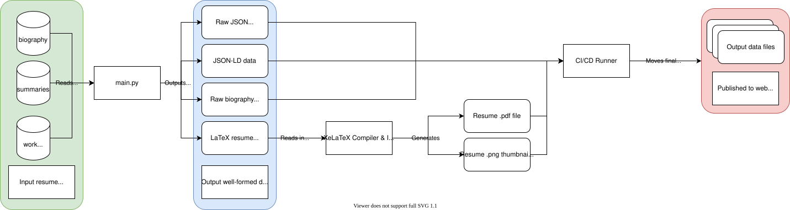

# Resume | Jason Yao

[](https://github.com/JasonYao/resume/actions/workflows/main.yml)

> Imagine what I could do if I wasn't doing this

The following respo contains all the code required in automatically
generating, distributing, and service-ifying my resume data.

## Link to Resume

To see the pdf version of this resume, please click the image below:
[
](https://www.jasonyao.com/resume/Resume_Jason_Yao.pdf)

## Resume Data API

I'm a big fan of data-driven architectures, so even my resume data is
in a machine and human readable form through the following commands below.

### JSON-LD Schema.org JSON Payload

* This data payload format is a [JSON-LD schema.org markup](https://jsonld.com/person/) for metadata
  content data
* The data payload can be found [here](https://www.jasonyao.com/resume/json-schema.json), and
  can be accessed over curl with:

```sh
# The jq just adds in some pretty-formatting, feel free to omit if you don't want it
curl https://www.jasonyao.com/resume/json-schema.json | jq '.'
```

### JSON Data

* This data payload format is a more complete and human-readable version of the resume data
  in JSON form, without having any of the metadata annotations from the JSON-LD version
* The data payload can be found [here](https://www.jasonyao.com/resume/raw-data.json), and
  can be accessed over curl with:

```sh
# The jq just adds in some pretty-formatting, feel free to omit if you don't want it
curl https://www.jasonyao.com/resume/raw-data.json | jq '.'
```

### Raw Biography Data

* This is just a raw text file with the latest version of my linkedin bio
* The raw biography text can be found [here](https://www.jasonyao.com/resume/biography.txt), and
  can be accessed over curl with:

```sh
curl https://www.jasonyao.com/resume/biography.txt
```

## Pipeline Overview



1. We use Python 3 for pre-processing and templating of data
2. [LaTeX](https://www.latex-project.org), and in particular
   [XeLaTeX](http://xetex.sourceforge.net/) is used to
   actually generate the PDF version of the resume, which
   is used for its UTF-8 goodness and implicit access to
   system-wide fonts.

## Install (macOS)

- [ ] Install pdf generation dependencies
    - Run `brew install --cask mactex`
- [ ] Install fonts on MacOS by clicking on the font
  files in the `fonts` directory
- [ ] Install imagemagick so that bin/build can
  generate thumbnails locally correctly
    - Run `brew install imagemagick`
- [ ] Installs a local python `.venv`
    - Run `uv venv --python 3.14.4`
- [ ] Installs all python dependencies
    - Run `uv sync`
- [ ] (Optional) Installs a good pdf viewer and IDE
    - Run `brew install --cask texmaker`

## Usage

To generate the pdf from the command-line:

```sh
bin/build
# OR
xelatex Resume_Jason_Yao.tex
```

## Testing

To run the automated tests:

```sh
bin/test
# OR
pytest
```

## Local GitHub Actions Debugging

By using the [act](https://github.com/nektos/act) library, we can execute the GitHub Actions CI/CD workflow
locally, enabling us to quickly debug if any issues arise.

Install by running:

```sh
brew install act
```

List detected workflows from repository root by running:

```sh
act -l
```

Dry-run by running:

```sh
act -n
```

Actually execute by running:

```sh
act
```

## Repo PAT Setup

The repo has 2 PATs setup:

1. `DEPLOY_ACCESS_TOKEN`
    - Kind: `Repo-level secret`
    - Permissions:
        - read-only: `content`
        - read-write: `pull-requests`
    - Usage: Used by all non-source and non-master branches to be able to upload the generated artifacts as a PR
      comment:
2. `SOURCE_DEPLOY_PAT`
    - Kind: `Environment-level secret`
    - Environment: `deploy`
    - Permissions:
        - read-write: `content`
    - Usage: To "deploy" from the `source` branch to the `master` branch by making a new commit and pushing to `master`.

## License

This repo is licensed under the terms of the MIT license,
a copy of which may be found [here](LICENSE)
